<div align="center">

<!-- BANNER SVG ANIMADO -->


<br/>

<!-- TYPING SVG DINÁMICO -->
<a href="https://git.io/typing-svg">
  
</a>

<br/>

<!-- SOCIAL BADGES -->
[](mailto:colquechuraa@gmail.com)
[](https://github.com/afergit)
[](https://linkedin.com/in/afergit)
[](https://afergit.github.io)

<br/>

<!-- VISITOR COUNTER -->


</div>

---


## 🧬 `> whoami`

```js
const afer = {
    role: "Software Engineer",
    location: "Perú 🇵🇪",
    education: "Ingeniería de Software",
    focus: ["Backend Development", "Cybersecurity", "Cloud Architecture"],
    currentlyLearning: ["Kubernetes", "Rust", "Red Team Ops"],
    funFact: "I break things to understand how they work 🔓"
};
```

<br clear="right"/>

---

## 🛠️ `> cat tech_stack.json`

<div align="center">

### 💻 Languages


### 🧩 Frameworks & Libraries


### 🔐 Security & DevOps


### 🗄️ Databases


</div>

---

## 📊 `> git log --stats`

<div align="center">


<br/>


<br/><br/>

<!-- GITHUB ACTIVITY GRAPH -->


</div>

---

## 🏆 `> achievements --all`

<div align="center">


</div>

---

## 🚀 `> ls featured_projects/`

<div align="center">

<!-- ═══════════════════════════════════════════════════════════ -->
<!-- PROYECTO 1: Eventos Aforo                                  -->
<!-- ═══════════════════════════════════════════════════════════ -->

<table>
<tr>
<td width="50%" valign="top">

### 📅 [Proyecto Eventos Aforo](https://github.com/afergit/proyecto-eventos-aforo)
> Sistema de gestión de eventos y control de aforo con registro en tiempo real.


</td>
<td width="50%" valign="top">

### 🔍 [Traductor de Fraude](https://github.com/afergit/traductor-de-fraude)
> Herramienta de análisis y detección de patrones fraudulentos con IA.


</td>
</tr>
</table>

</div>

---

## 📈 `> metrics --detailed`

<div align="center">

```text
 ╔══════════════════════════════════════════════════════════╗
 ║                  📡 SYSTEM STATUS                       ║
 ╠══════════════════════════════════════════════════════════╣
 ║                                                         ║
 ║   🟢 Status ............... ONLINE & BUILDING           ║
 ║   🎯 Focus ................ Backend & Security          ║
 ║   🔭 Exploring ............ Cloud Architecture          ║
 ║   🌱 Learning ............. Kubernetes & Rust           ║
 ║   💬 Ask me about ......... Python, Security, APIs      ║
 ║   ⚡ Fun fact .............. I automate everything       ║
 ║   📫 Reach me ............. colquechuraa@gmail.com      ║
 ║                                                         ║
 ╚══════════════════════════════════════════════════════════╝
```

</div>

---

<div align="center">

### 💀 `> hack the planet`


<br/>


</div>
