<div align="center">

<!-- BANNER SVG ANIMADO CYBERPUNK -->


<br/>

<!-- TYPING SVG INTERACTIVO -->
<a href="https://git.io/typing-svg">
  
</a>
<br/>

<br/>

<br/>

<!-- BADGES SOCIALES Y DE CONTACTO -->
<p align="center">
  <a href="mailto:colquechuraa@gmail.com">
    
  </a>
  <a href="https://github.com/afergit">
    
  </a>
  <a href="https://linkedin.com/in/afergit">
    
  </a>
</p>

<!-- CONTADORES DE TELEMETRÍA -->
<p align="center">
  
  
</p>

</div>

---

## 🧬 `> whoami --profile`

```typescript
interface SoftwareEngineer {
  name: string;
  alias: string;
  role: string;
  coreSkills: string[];
  securityFocus: string[];
  currentMission: string;
}

const afer: SoftwareEngineer = {
  name: "Afer",
  alias: "afergit",
  role: "Software Engineer & Security Analyst",
  coreSkills: ["Distributed Systems", "Backend APIs", "Clean Architecture", "DevSecOps"],
  securityFocus: ["AppSec", "Penetration Testing", "Threat Modeling", "OWASP Top 10"],
  currentMission: "Engineering bulletproof scalable architectures with proactive security."
};
```

---

## 🛠️ `> sysinfo --stack`

<div align="center">

### 💻 Languages & Runtimes


### 🧩 Frameworks & Web Platforms


### 🔐 Cybersecurity & DevSecOps


### 🗄️ Persistence & Cloud Data


</div>

---

## 📊 `> git analytics --telemetry`

<div align="center">

<!-- TARJETA DE ESTADÍSTICAS EXTENDIDA CON PROTOCOLO CACHE SEGURO -->
<a href="https://github.com/afergit">
  
</a>
<!-- STREAK METRICS ACTIVO -->
<a href="https://github.com/afergit">
  
</a>

<br/>

<!-- TOP LANGUAGES ROBUSTO -->
<a href="https://github.com/afergit">
  
</a>

<br/>

<!-- ACTIVITY GRAPH AUTOGESTIONADA (generada por GitHub Actions, sin depender de instancias externas) -->


</div>

---

## 🚀 `> ls -la featured_deployments/`

<div align="center">

<table width="100%">
<tr>
<td width="50%" valign="top">

### 🛡️ [Proyecto Eventos Aforo](https://github.com/afergit/proyecto-eventos-aforo)
> **Arquitectura de monitoreo, telemetría y control de capacidad en tiempo real.**
- **Enfoque:** Concurrencia alta, trazabilidad de eventos y dashboards en vivo.
- **Stack:** `Node.js` • `Express` • `MongoDB` • `Docker` • `WebSockets`
- **Estado:** Producción / En expansión modular.

<p align="left">
  
  
</p>

</td>
<td width="50%" valign="top">

### 🔍 [Traductor de Fraude](https://github.com/afergit/traductor-de-fraude)
> **Engine heurístico para clasificación y detección de vectores de fraude y anomalías.**
- **Enfoque:** Detección de patrones maliciosos, parsing de transacciones y sanitización.
- **Stack:** `Python` • `FastAPI / Flask` • `PostgreSQL` • `Security Heuristics`
- **Estado:** Optimización y testing de payloads.

<p align="left">
  
  
</p>

</td>
</tr>
</table>

</div>

---

## 🛰️ `> terminal --status-matrix`

```text
 ╔══════════════════════════════════════════════════════════════════╗
 ║                📡 SEC-OPS & ENGINEERING STATUS                  ║
 ╠══════════════════════════════════════════════════════════════════╣
 ║                                                                  ║
 ║   🟢 System Status .......... OPERATIONAL // ALL SYSTEMS GO      ║
 ║   🛡️ Focus Area ............. AppSec, Backend & Cloud Resilience ║
 ║   ⚙️ Core Paradigm .......... Zero Trust & High Concurrency      ║
 ║   🌱 Ongoing Deep-Dive ...... Kubernetes Operators & Rust        ║
 ║   💬 Discussions ............ API Design, Threat Modeling        ║
 ║   📫 Direct Line ............ colquechuraa@gmail.com             ║
 ║                                                                  ║
 ╚══════════════════════════════════════════════════════════════════╝
```

---

<div align="center">

### 🐍 `> execute snake_contribution_grid`

<!-- SNAKE GENERADA DINÁMICAMENTE POR GITHUB ACTIONS -->
<picture>
  <source media="(prefers-color-scheme: dark)" srcset="https://raw.githubusercontent.com/afergit/afergit/output/github-snake-dark.svg">
  <source media="(prefers-color-scheme: light)" srcset="https://raw.githubusercontent.com/afergit/afergit/output/github-snake.svg">
  
</picture>

<br/><br/>

<!-- WAVE FOOTER CYBERPUNK -->


</div>
